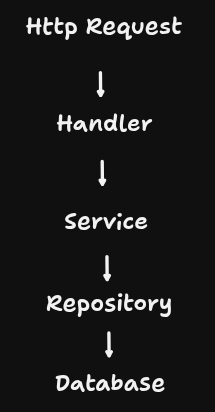

+++
date = '2026-11-19T22:10:30+05:30'
draft = false
comments = true
title = 'Dependency Injection & Dependency Inversion in Go'
description = "Keeping layers and components loosely coupled is one of the most important things in Backend Engineering, we will discuss dep. injection and dep. inversion in this Blog."
tags = ['golang', 'backend architecture']
categories = ['Backend']
+++

When building a backend application in Go, we often divide the application into multiple layers:

- **Handler:** Receives HTTP requests and sends HTTP responses.
- **Service:** Contains the application's business logic.
- **Repository:** Handles communication with the database or another data source.

This separation makes our code easier to understand and maintain. However, simply separating code into different packages does not automatically make an application loosely coupled.

Consider a service that directly creates its own repository:

```go
type UserService struct {
    repo *UserRepository
}

func NewUserService() *UserService {
    return &UserService{
        repo: NewUserRepository(),
    }
}
```

At first glance, this looks perfectly reasonable. But there is a problem: `UserService` is responsible for creating its own dependency.

What happens when we want to replace PostgreSQL with an in-memory repository? What if we want to test the service without connecting to a real database?

We would have to modify the service itself.

This is where two important software engineering concepts come into play:

1. Dependency Injection (DI)
2. Dependency Inversion Principle (DIP)

Although these concepts are closely related, they solve different problems.

Let's understand them by building a simple layered Go backend.

---

## 1. Understanding Dependencies

Before discussing Dependency Injection, we need to understand what a dependency actually is.

A dependency is simply another component that a piece of code needs to perform its job.

For example, consider a `UserService` that needs to retrieve user information from a database.

```go
type UserService struct {
    repo *UserRepository
}
```

Here, `UserService` depends on `UserRepository`.

In other words, the service cannot perform its database-related operations without the repository.

We can visualize this relationship as:

[](https://github.com/abhyuday-fr/abhyuday-fr.github.io/blob/main/Images/Backend/depInjdepInv/dependencies.png)


The problem is not that these components depend on one another. Dependencies are unavoidable in software.

The real problem is **how those dependencies are created and managed.**

---

## 2. What Is Dependency Injection?

Dependency Injection is a technique in which an object receives the dependencies it needs from an external source instead of creating those dependencies itself.

Let's revisit our previous example.

Instead of allowing `UserService` to create its repository, we can pass the repository through its constructor.

```go
type UserService struct {
    repo *UserRepository
}

func NewUserService(repo *UserRepository) *UserService {
    return &UserService{
        repo: repo,
    }
}
```

Now, `UserService` does not need to know how the repository is created.

Someone else is responsible for creating the repository and providing it to the service.

For example:

```go
repo := NewUserRepository()
service := NewUserService(repo)
```

This is Dependency Injection.

Notice that we have not introduced any framework, container, or special Go feature. We are simply passing a dependency as a function argument.

### Different ways to inject dependencies

There are several ways to perform dependency injection:

**1. Constructor Injection**

Dependencies are provided when creating a component.

```go
func NewUserService(repo UserRepository) *UserService {
    return &UserService{repo: repo}
}
```

**2. Setter Injection**

Dependencies are provided after the component has been created.

```go
func (s *UserService) SetRepository(repo UserRepository) {
    s.repo = repo
}
```

**3. Field Injection**

Dependencies are assigned directly to exported fields.

```go
type UserService struct {
    Repo UserRepository
}
```

In Go, constructor injection is generally the preferred approach because it makes dependencies explicit and allows us to ensure that a component is properly initialized before using it.

---

## 3. What Is the Dependency Inversion Principle?

Now that we understand Dependency Injection, let's discuss Dependency Inversion.

The Dependency Inversion Principle is one of the five SOLID principles of object-oriented design.

It states:

- High-level modules should not depend on low-level modules. Both should depend on abstractions.
- Abstractions should not depend on details. Details should depend on abstractions.

Let's understand this using our backend architecture.

Suppose our service directly depends on a concrete PostgreSQL repository:

```go
type UserService struct {
    repo *PostgresUserRepository
}
```

Here:

- `UserService` represents high-level business logic.
- `PostgresUserRepository` represents a low-level database implementation.

The business logic is directly coupled to the database implementation.

If we replace PostgreSQL with MongoDB, we might need to modify our service.

DIP suggests that instead of depending on a concrete implementation, the service should depend on an abstraction.

In Go, we can achieve this using interfaces.

```go
type UserRepository interface {
    GetByID(id int64) (*User, error)
}
```

Now, our service depends on the interface rather than a specific database implementation.

```go
type UserService struct {
    repo UserRepository
}

func NewUserService(repo UserRepository) *UserService {
    return &UserService{
        repo: repo,
    }
}
```

Our PostgreSQL repository can implement this interface:

```go
type PostgresUserRepository struct {
    db *sql.DB
}

func (r *PostgresUserRepository) GetByID(id int64) (*User, error) {
    // Execute database query.
    return nil, nil
}
```

Go does not require us to explicitly declare that `PostgresUserRepository` implements `UserRepository`.

If its method set satisfies the interface, it implements that interface automatically.

This is an important feature of Go's implicit interface implementation.

### How does dependency inversion change our architecture?

Before applying DIP:

```text
UserService
     |
     v
PostgresUserRepository
     |
     v
   Database
```

After applying DIP:

```text
       UserService
            |
            v
     UserRepository
        (Interface)
            ^
            |
   PostgresUserRepository
            |
            v
         Database
```

The important difference is that the business layer no longer depends on the concrete database implementation.

The repository implementation satisfies an abstraction required by the service.

This makes it possible to change the underlying database implementation without changing the business logic.

---

## 4. Applying DI and DIP to a Layered Go Backend

Let's put both concepts together by implementing a simple user backend.

Our application will have three layers:

```text
             HTTP Request
                  |
                  v
          +---------------+
          |    Handler    |
          +---------------+
                  |
                  v
          +---------------+
          |    Service    |
          +---------------+
                  |
                  v
          +---------------+
          |   Repository  |
          +---------------+
                  |
                  v
              PostgreSQL
```

We'll keep the implementation simple and focus on dependency management.

### Step 1: Define the User Model

```go
package model

type User struct {
    ID    int64  `json:"id"`
    Name  string `json:"name"`
    Email string `json:"email"`
}
```

This represents the user entity used by our application.

### Step 2: Implement the Repository Layer

The repository layer handles data access.

First, define the repository interface:

```go
package repository

import "myapp/model"

type UserRepository interface {
    GetByID(id int64) (*model.User, error)
}
```

Now, implement it using PostgreSQL:

```go
package repository

import (
    "database/sql"
    "myapp/model"
)

type PostgresUserRepository struct {
    db *sql.DB
}

func NewPostgresUserRepository(db *sql.DB) *PostgresUserRepository {
    return &PostgresUserRepository{
        db: db,
    }
}

func (r *PostgresUserRepository) GetByID(
    id int64,
) (*model.User, error) {

    user := &model.User{}

    query := `
        SELECT id, name, email
        FROM users
        WHERE id = $1
    `

    err := r.db.QueryRow(query, id).Scan(
        &user.ID,
        &user.Name,
        &user.Email,
    )

    if err != nil {
        return nil, err
    }

    return user, nil
}
```

The repository knows how to communicate with PostgreSQL, but the service does not need to know anything about SQL queries.

### Step 3: Implement the Service Layer

The service layer contains our business logic.

It depends on the repository interface, not the PostgreSQL implementation.

```go
package service

import (
    "errors"
    "myapp/model"
    "myapp/repository"
)

type UserService struct {
    repo repository.UserRepository
}

func NewUserService(repo repository.UserRepository) *UserService {
    return &UserService{
        repo: repo,
    }
}

func (s *UserService) GetUser(id int64) (*model.User, error) {
    if id <= 0 {
        return nil, errors.New("invalid user ID")
    }

    return s.repo.GetByID(id)
}
```

Notice a few important things:

1. The service does not create the repository.
2. The service depends on an interface.
3. The service is responsible for business-related validation.
4. The service does not know whether the data comes from PostgreSQL, MySQL, MongoDB, or an in-memory implementation.

This is where DI and DIP work together.

### Step 4: Implement the Handler Layer

The handler receives HTTP requests and communicates with the service.

We can also introduce an interface for the service.

```go
package handler

import (
    "encoding/json"
    "net/http"
    "strconv"

    "github.com/go-chi/chi/v5"
    "myapp/model"
)

type UserService interface {
    GetUser(id int64) (*model.User, error)
}

type UserHandler struct {
    service UserService
}

func NewUserHandler(service UserService) *UserHandler {
    return &UserHandler{
        service: service,
    }
}

func (h *UserHandler) GetUser(w http.ResponseWriter, r *http.Request) {
    id, err := strconv.ParseInt(
        chi.URLParam(r, "id"),
        10,
        64,
    )

    if err != nil {
        http.Error(w, "Invalid user ID", http.StatusBadRequest)
        return
    }

    user, err := h.service.GetUser(id)

    if err != nil {
        http.Error(w, "Unable to retrieve user", http.StatusNotFound)
        return
    }

    w.Header().Set("Content-Type", "application/json")

    json.NewEncoder(w).Encode(user)
}
```

Here, the handler depends on a `UserService` interface rather than the concrete service implementation.

This is another application of DIP.

It also allows us to inject different service implementations when needed.

---

## 5. Where Does Dependency Injection Actually Happen?

We've created our handler, service, and repository, but we haven't connected them yet.

So, where should we create these components and inject their dependencies?

A common approach is to use the application's entry point, usually `main.go`, as the composition root.

A composition root is the place where the application creates its concrete dependencies and connects them together.

```go
package main

import (
    "database/sql"
    "log"
    "net/http"

    "github.com/go-chi/chi/v5"

    "myapp/handler"
    "myapp/repository"
    "myapp/service"
)

func main() {
    db, err := sql.Open("postgres", "your-database-dsn")

    if err != nil {
        log.Fatal(err)
    }

    if err := db.Ping(); err != nil {
        log.Fatal(err)
    }

    defer db.Close()

    // Create repository.
    userRepo := repository.NewPostgresUserRepository(db)

    // Inject repository into service.
    userService := service.NewUserService(userRepo)

    // Inject service into handler.
    userHandler := handler.NewUserHandler(userService)

    // Configure routes.
    router := chi.NewRouter()

    router.Get("/users/{id}", userHandler.GetUser)

    log.Fatal(http.ListenAndServe(":8080", router))
}
```

The dependency graph is now constructed in one place:

```text
             main.go
                |
                v
      PostgresUserRepository
                |
                v
           UserService
                |
                v
           UserHandler
                |
                v
           HTTP Router
```

The important thing is that each component receives its dependencies from outside.

None of the individual layers needs to know how the other components are constructed.

This is Dependency Injection in practice.

---

## 6. Why Does This Make Testing Easier?

One of the biggest advantages of DI and DIP is testability.

Suppose we want to test `UserService.GetUser()`.

Without dependency injection, the service might create a real PostgreSQL repository internally. Our test would then require a database connection.

With our current architecture, we can provide a fake repository.

```go
type MockUserRepository struct {
    User *model.User
    Err  error
}

func (m *MockUserRepository) GetByID(
    id int64,
) (*model.User, error) {
    return m.User, m.Err
}
```

Now we can test the service without PostgreSQL:

```go
func TestGetUser(t *testing.T) {
    expected := &model.User{
        ID:    1,
        Name:  "Abhyuday",
        Email: "abby@example.com",
    }

    mockRepo := &MockUserRepository{
        User: expected,
    }

    userService := service.NewUserService(mockRepo)

    user, err := userService.GetUser(1)

    if err != nil {
        t.Fatalf("unexpected error: %v", err)
    }

    if user.ID != expected.ID {
        t.Errorf("expected ID %d, got %d", expected.ID, user.ID)
    }
}
```

We replaced the real repository with a fake implementation.

The service does not care because both implementations satisfy the same interface.

This is one of the most practical benefits of designing around abstractions.

---

## 7. DI vs DIP: What Is the Actual Difference?

These concepts are related, but they are not interchangeable.

| Dependency Injection | Dependency Inversion |
|---|---|
| A technique | A design principle |
| Focuses on providing dependencies | Focuses on dependency relationships |
| Helps avoid creating dependencies internally | Helps avoid coupling high-level code to low-level implementations |
| Commonly implemented through constructors | Commonly implemented through interfaces in Go |

Think of it this way:

**Dependency Injection answers:**

"How does this component receive the dependencies it needs?"

**Dependency Inversion answers:**

"How should this component depend on other components?"

You can use DI without DIP. For example, injecting a concrete PostgreSQL repository into a service is DI, but it does not achieve the abstraction-based dependency inversion we discussed.

Similarly, defining interfaces alone does not mean you have implemented DI. You still need to provide the actual implementations to the components that use them.

Together, these concepts help us build more flexible and maintainable applications.

---

## 8. A Few Go-Specific Best Practices

When implementing DI and DIP in Go, keep these points in mind:

**1. Prefer constructor injection.**

Make dependencies explicit through constructors instead of relying on global variables or hidden initialization.

**2. Keep interfaces small.**

Go encourages small interfaces. Define interfaces around the behavior a consumer actually needs rather than creating unnecessarily large interfaces.

**3. Define interfaces close to their consumers.**

For example, if the service needs a repository, the service package can define the repository interface it consumes. The concrete repository can satisfy it without importing the service package.

**4. Avoid unnecessary interfaces.**

Not every struct needs an interface. If a component has only one implementation and there is no meaningful need for substitution or isolation, a concrete dependency may be perfectly fine.

**5. Avoid introducing a DI framework too early.**

Go's functions, structs, and interfaces are usually sufficient for manual dependency injection. Libraries such as Google Wire can help with larger dependency graphs, but they are not mandatory.

---

## Conclusion

Dependency Injection and Dependency Inversion are two important concepts that help us manage dependencies in backend applications.

Dependency Injection allows us to provide dependencies from outside a component, while Dependency Inversion helps us structure those dependencies around abstractions rather than concrete implementations.

In a layered Go backend:

- Handlers depend on service abstractions.
- Services depend on repository abstractions.
- Repositories implement the required data-access behavior.
- The application entry point wires the concrete implementations together.

The result is an application where business logic is not tightly coupled to HTTP frameworks, database drivers, or specific infrastructure implementations.

And perhaps the most important lesson is this:

**Good architecture is not about introducing more layers, interfaces, or abstractions. It is about making dependencies explicit and keeping components independent of implementation details that they do not need to know about.**
