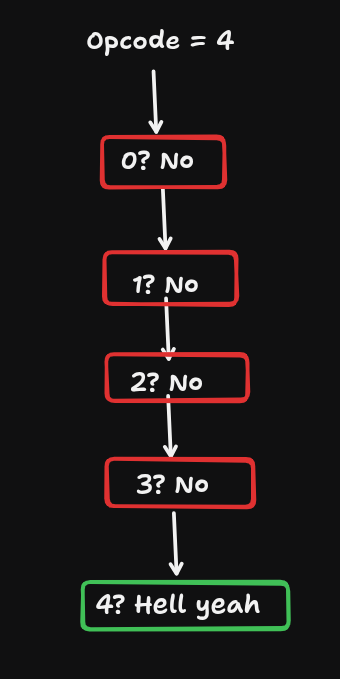
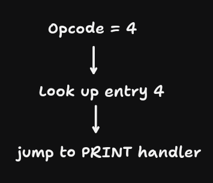

+++
date = '2026-10-11T13:00:12+05:30'
draft = false
comments = true
title = 'Branch Tables & Computed gotos'
description = "We'll make a tiny virtual machine to understand what branches and branch tables are, how normal switch statements work and what computed gotos are"
tags = ['cpp', 'low-latency', 'gcc']
categories = ['Systems Programming', 'Low-Latency']
+++

Computed gotos are a GNU C extension, not a standard C feature.

## A Tiny Virtual Machine

### What does this one do

Suppose we want to build a machine that executes instructions such as:

| Opcode	| Meaning |
| ------|----------|
|0 |	Push the number 10 onto the stack |
|1	| Push the number 20 onto the stack |
| 2 |	Add the top two numbers |
| 3 |	Subtract the top two numbers |
| 4 |	Print the top number |
| 5 |	Halt execution |

Consider this program :

```shell
PUSH 10
PUSH 20
ADD
PRINT
HALT
```

The expected output is:

```shell
30
```

Our virtual machine has two main responsibilities:
1. Read the next instruction.
2. Decide what operation to execute.

That second responsibility is where branching comes in.

### The Normal `switch` approach

```c

#include <stdio.h>

enum {
    OP_PUSH10 = 0,
    OP_PUSH20 = 1,
    OP_ADD    = 2,
    OP_SUB    = 3,
    OP_PRINT  = 4,
    OP_HALT   = 5
};

int main(void) {
    int program[] = {
        OP_PUSH10,
        OP_PUSH20,
        OP_ADD,
        OP_PRINT,
        OP_HALT
    };

    int stack[100];
    int sp = 0;  // stack pointer
    int pc = 0;  // program counter

    while (1) {
        int opcode = program[pc++];

        switch (opcode) {
            case OP_PUSH10:
                stack[sp++] = 10;
                break;

            case OP_PUSH20:
                stack[sp++] = 20;
                break;

            case OP_ADD:
                stack[sp - 2] += stack[sp - 1];
                sp--;
                break;

            case OP_SUB:
                stack[sp - 2] -= stack[sp - 1];
                sp--;
                break;

            case OP_PRINT:
                printf("%d\n", stack[sp - 1]);
                break;

            case OP_HALT:
                return 0;

            default:
                fprintf(stderr, "Invalid opcode: %d\n", opcode);
                return 1;
        }
    }
}

```

(I know this is not very safe and very vulnerable, it's only for example)

## What is a Branch?

A branch is a change in the normal sequence of instruction execution.

In our `switch`...

```c
switch (opcode) {
    case 0:
        push10();
        break;

    case 1:
        push20();
        break;

    case 2:
        add();
        break;

    default:
        invalid_opcode();
}
```

Conceptually, the program needs to select one of four destinations.
One possible implementation is a chain of comparisons:

```c
if (opcode == 0) {
    push10();
} else if (opcode == 1) {
    push20();
} else if (opcode == 2) {
    add();
} else {
    invalid_opcode();
}
```

This is one way of implementing the decision. It is not necessarily how your compiler will implement the switch.

If the compiler generates a comparison chain, the processor might execute something resembling:

```shell
Check opcode == 0
   |
   +-- Yes --> Handler 0
   |
   +-- No --> Check opcode == 1
                 |
                 +-- Yes --> Handler 1
                 |
                 +-- No --> Check opcode == 2
                               |
                               +-- Yes --> Handler 2
                               |
                               +-- No --> Default handler
```

If the opcode is 2, it may need to pass multiple comparisons before reaching the correct handler.
But what if there are 100 instructions instead of 4?
A long comparison chain can be inefficient, particularly if later cases are frequently executed.
This brings us to the branch table.

## What is a Branch Table?

A branch table is a table of possible control-flow destinations, allowing a program to select where execution should go.

You'll also hear the term ***jump table***, which is the more common term when discussing compiler-generated tables of branch destinations.

Imagine that instead of checking each opcode individually, we keep a table like this:

| Opcode | Destination |
|--------|-------------|
| 0 | PUSH10 handler |
| 1 | PUSH20 handler |
| 2 | ADD handler |
| 3 | SUB handler |
| 4 | PRINT handler |
| 5 | HALT handler |

Instead of asking six separate questions, we use the opcode as an index into a table.

The exact representation depends on the compiler, target architecture, and optimization choices.

It is not necessarily a table of C function pointers. A compiler can implement a switch jump table without creating C functions for every case.

Also, a branch table is not necessarily a table of branch instructions. It is typically a table of destinations used by a branch or indirect jump.

*A dense table of destinations can avoid a sequence of equality tests.*

### Why use a table instead of comparisons?

Let's compare the two approaches conceptually.

**Approach A: Comparison Chain**




**Approach B: Jump table**



### NOTE

For some switches, a compiler can use a tree of comparisons, ranges, or other optimized branching strategies.

For example, a switch containing cases 10, 100, 1000, and 10000 is very different from one containing every integer from 0 to 100.

The compiler considers factors such as:
- How many cases exist.
- How densely they are distributed.
- The target architecture.
- Optimization settings.
- Profile information, if available.

A switch is a high-level language construct. It doesn't promise a specific machine-code implementation.

This is why you should never assume that `switch` automatically means slow comparison chains.

## Computed gotos

A **computed goto** lets you jump to a destination determined at runtime, using an expression that evaluates to a target address.

You obtain the address of a label using GNU C's &&label extension.

```c
#include <stdio.h>

int main(void) {
    void *target = &&hello;

    goto *target;

    printf("This will be skipped\n");

hello:
    printf("Hello from the computed goto!\n");

    return 0;
}
```

- here `&&hello` obtains the address of the label named `hello`
- `target` is a pointer to a label inside the current function

A few important details:
- This is a GNU C extension, not ISO C.
- The target label must belong to the same function.
- The target must be a valid label address for that function.
- An invalid target can cause undefined behavior.

### Multiple Destinations

```c
#include <stdio.h>

int main(void) {
    int choice = 2;

    static void *targets[] = {
        &&option0,
        &&option1,
        &&option2
    };

    if (choice < 0 || choice >= 3) {
        return 1;
    }

    goto *targets[choice];

option0:
    printf("Option 0\n");
    return 0;

option1:
    printf("Option 1\n");
    return 0;

option2:
    printf("Option 2\n");
    return 0;
}
```

The output will be:

```shell
Option 2
```

## Using Computed gotos in our VM

### 1. Extract the handlers into labels

```c
dispatch:
    /* Fetch an instruction and select its handler. */

op_push10:
    stack[sp++] = 10;
    /* Continue execution. */

op_push20:
    stack[sp++] = 20;
    /* Continue execution. */

op_add:
    stack[sp - 2] += stack[sp - 1];
    sp--;
    /* Continue execution. */

op_sub:
    stack[sp - 2] -= stack[sp - 1];
    sp--;
    /* Continue execution. */

op_print:
    printf("%d\n", stack[sp - 1]);
    /* Continue execution. */

op_halt:
    return 0;
```

We have named the destinations, but we haven't yet established how execution chooses one.

Also, be careful: if execution simply falls through from one label to the next, the VM would execute multiple handlers unintentionally.

We need explicit control transfers.

### 2. Create a dispatch table

```c
static void *dispatch_table[] = {
    &&op_push10,  // Opcode 0
    &&op_push20,  // Opcode 1
    &&op_add,     // Opcode 2
    &&op_sub,     // Opcode 3
    &&op_print,   // Opcode 4
    &&op_halt     // Opcode 5
};
```

The relationship is...

| Opcode | Table entry | Destination |
|--------|-------------|-------------|
| 0 | dispatch_table[0] | op_push10 
| 1 | dispatch_table[1] | op_push20
| 2 | dispatch_table[2] | op_add
| 3 | dispatch_table[3] | op_sub
| 4 | dispatch_table[4] | op_print
| 5 | dispatch_table[5] | op_halt

**NOTE**: The order matters. Opcode 2 must map to the ADD handler, not the SUB handler.

### 3. Replace the `switch` with an indirect jump

```c
int opcode = program[pc++];

if (opcode < 0 || opcode >= 6) {
    fprintf(stderr, "Invalid opcode: %d\n", opcode);
    return 1;
}

goto *dispatch_table[opcode];
```

The range check protects the table lookup.

So far, we've created a table and replaced the `switch` with a computed goto. But there is still one important problem to solve.

### 4. Make execution continue to the next instruction

In our computed-goto VM, we must explicitly return to instruction dispatch.

One way is to use a shared dispatch label:

```c
dispatch:
    opcode = program[pc++];
    goto *dispatch_table[opcode];
```

Then every handler ends with:

```c
goto dispatch;
```

This works, but it still has a shared dispatch point.

### 5. The complete computed goto VM

```c

#include <stdio.h>

enum {
    OP_PUSH10 = 0,
    OP_PUSH20 = 1,
    OP_ADD    = 2,
    OP_SUB    = 3,
    OP_PRINT  = 4,
    OP_HALT   = 5,
    OP_COUNT  = 6
};

int main(void) {
    int program[] = {
        OP_PUSH10,
        OP_PUSH20,
        OP_ADD,
        OP_PRINT,
        OP_HALT
    };

    int stack[100];
    int sp = 0;
    int pc = 0;

    static void *dispatch_table[OP_COUNT] = {
        &&op_push10,
        &&op_push20,
        &&op_add,
        &&op_sub,
        &&op_print,
        &&op_halt
    };

    /*
     * Fetch the next opcode, validate it,
     * and jump to its handler.
     */
#define DISPATCH() do {                         \
        if (pc >= (int)(sizeof(program) /       \
                        sizeof(program[0]))) {  \
            fprintf(stderr, "Missing HALT\n");  \
            return 1;                           \
        }                                       \
        int opcode = program[pc++];             \
        if (opcode < 0 || opcode >= OP_COUNT) { \
            fprintf(stderr, "Invalid opcode\n");\
            return 1;                           \
        }                                       \
        goto *dispatch_table[opcode];            \
    } while (0)

    DISPATCH();

op_push10:
    if (sp >= 100) {
        fprintf(stderr, "Stack overflow\n");
        return 1;
    }
    stack[sp++] = 10;
    DISPATCH();

op_push20:
    if (sp >= 100) {
        fprintf(stderr, "Stack overflow\n");
        return 1;
    }
    stack[sp++] = 20;
    DISPATCH();

op_add:
    if (sp < 2) {
        fprintf(stderr, "Stack underflow in ADD\n");
        return 1;
    }
    stack[sp - 2] += stack[sp - 1];
    sp--;
    DISPATCH();

op_sub:
    if (sp < 2) {
        fprintf(stderr, "Stack underflow in SUB\n");
        return 1;
    }
    stack[sp - 2] -= stack[sp - 1];
    sp--;
    DISPATCH();

op_print:
    if (sp < 1) {
        fprintf(stderr, "Stack underflow in PRINT\n");
        return 1;
    }
    printf("%d\n", stack[sp - 1]);
    DISPATCH();

op_halt:
    return 0;

#undef DISPATCH
}

```

### Shared VS Replicated dispatch

Our implementation above has a dispatch sequence like this:

```shell
             +--------------------+
             | Fetch next opcode  |
             | Validate opcode    |
             | Indirect jump      |
             +--------------------+
                       |
             +---------+---------+
             |         |         |
             v         v         v
          PUSH10      ADD       PRINT
             |         |         |
             +---------+---------+
                       |
                       v
                  DISPATCH
```

All handlers return to the same dispatch sequence.
This is called **centralized dispatch**.

The more interesting approach is to put the dispatch operation at the end of each handler, allowing each handler to have its own indirect branch instruction.

That is commonly called **replicated dispatch**, and it is a major reason computed gotos are interesting for interpreter implementations.

```shell
                 Initial dispatch
                       |
                       v
                 +-----------+
                 |  PUSH10   |
                 | Execute   |
                 | Dispatch  |
                 +-----------+
                       |
                       v
                 +-----------+
                 |  PUSH20   |
                 | Execute   |
                 | Dispatch  |
                 +-----------+
                       |
                       v
                 +-----------+
                 |    ADD    |
                 | Execute   |
                 | Dispatch  |
                 +-----------+
                       |
                       v
                 +-----------+
                 |   PRINT   |
                 | Execute   |
                 | Dispatch  |
                 +-----------+
```

The important distinction is that the dispatch operation after PUSH10 is at a different machine-code location from the dispatch operation after ADD.
Each handler contains its own dispatch instruction.

Here is the core pattern:

```c
op_push10:
    stack[sp++] = 10;
    opcode = program[pc++];
    goto *dispatch_table[opcode];

op_push20:
    stack[sp++] = 20;
    opcode = program[pc++];
    goto *dispatch_table[opcode];

op_add:
    stack[sp - 2] += stack[sp - 1];
    sp--;
    opcode = program[pc++];
    goto *dispatch_table[opcode];
```

## Why can computed gotos be faster?

1. **Reducing dispatch overhead**: 

    Suppose, purely as an illustrative model, that an interpreter spends 60% of its runtime on dispatch and 40% on executing the actual instructions.

    If we somehow halved the dispatch cost, the total runtime would become:

    T_new = 0.60T * 0.5 + 0.40T = 0.70T

    The theoretical speedup would be:

    S = T / 0.70T = 1.43 (approx)

    That's approximately a 1.43× speedup, even though we haven't made the individual arithmetic instructions faster.

    This is an illustration of [*Amdahl's law*](https://en.wikipedia.org/wiki/Amdahl's_law), not a benchmark result for computed gotos. Actual dispatch costs and improvements depend on the implementation and workload.

2. **Branch Prediction**:

    A processor doesn't just predict whether a branch will be taken. It also needs to predict the branch's destination.

    With a shared indirect branch instruction, the same branch site might jump to many different handlers. When opcode sequences are irregular, predicting those destinations can be difficult.

    With replicated dispatch, the ADD handler and the PUSH handler can each have their own indirect branch instruction.

    If an ADD instruction is commonly followed by PUSH, the dispatch branch at the end of ADD may become easier to predict than one shared branch that handles every possible preceding opcode.

    This is a potential benefit, not a guarantee. 

    Modern CPUs have sophisticated predictors, and their performance depends on architecture and workload.
