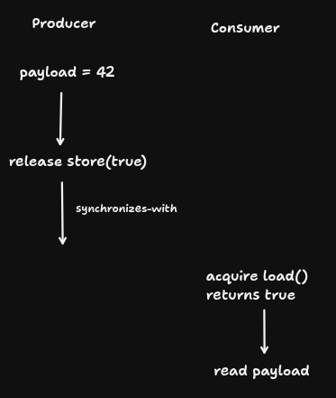

+++
date = '2026-10-14T23:27:41+05:30'
draft = false
comments = true
description = "Understand the memory models in atomics in C++ once and for all"
title = 'Atomic and Memory Ordering in C++'
tags = ['cpp', 'multithreading', 'lock-free']
categories = ['Multithreading']
+++

I won't discuss about the atomic operations much so you can get the detailed information about them [here](https://www.sciencedirect.com/topics/computer-science/atomic-operation) 

## `std::atomic` in C++

Introduced in C++11, it is a library template that provides *atomic operations* on primitive and custom data types. it executes completely without any possibility of being interrupted or observed in a half-finished state by another thread.

This prevents data races in multithreaded environments without needing heavy synchronization primitives like `std::mutex`.

## Memory-Order

C++  provides *six* memory-order options:
- `std::memory_order_relaxed`
- `std::memory_order_consume` (deprecated in C++26)
- `std::memory_order_acquire`
- `std::memory_order_release`
- `std::memory_order_acq_rel`
- `std::memory_order_seq_cst`

## Three Important Concepts

Before learning the individual memory orders, understand these three terms.

### 1. Sequenced-Before

Within one thread, if one operation is sequenced before another, the first must precede the second in the abstract execution of the program.

```cpp
int x = 10;
int y = x + 5;
```

The assignment to x is sequenced before the computation and assignment to y.

### 2. Sequenced-With

Certain atomic operations in different threads can establish a synchronization relationship.

For example, a release store can synchronize with an acquire load that reads the value written by that store, or an appropriate value from its release sequence.

```cpp
// Thread 1
data = 100;
flag.store(true, std::memory_order_release);

// Thread 2
if (flag.load(std::memory_order_acquire)) {
    // If the load reads the published true value,
    // the earlier write to data is visible here.
    use(data);
}
```

### 3. Happens-Before

The `happens-before` relationship is the crucial foundation of C++ concurrency.

In the example above:

```cpp
std::atomic<bool> ready = false;
int data = 0;

// Thread 1
data = 42;                          // 1. Prepare data
ready.store(true, std::memory_order_release); // 2. Release: synchronizes-with acquire

// Thread 2
while (!ready.load(std::memory_order_acquire)); // 3. Acquire: observes the store
// 4. Data is now guaranteed to be 42
std::cout << data;    
```

Without these ordering constraints (e.g., using memory_order_relaxed), atomic operations only guarantee indivisibility (atomicity) but do not establish a happens-before relationship, potentially allowing other threads to see stale or out-of-order memory states.

## Memory Ordering

### 1. `std::memory_order_relaxed` (Weakest Ordering)

In simple (or not so simple) words, it guarantees atomicity and per-atomic-object modification order, but no inter-thread synchronization or ordering of unrelated memory operations.

Let's understand with an example:

```cpp
#include <atomic>
#include <thread>
#include <iostream>

std::atomic<int> counter{0};

void increment() {
    for (int i = 0; i < 100'000; ++i) {
        counter.fetch_add(1, std::memory_order_relaxed);
    }
}

int main() {
    std::thread t1(increment);
    std::thread t2(increment);

    t1.join();
    t2.join();

    std::cout << counter.load(std::memory_order_relaxed) << '\n';
}
```

Output : `200000`

The counter is the only shared state whose correctness matters here. We don't need an increment to publish other data, and we don't need one thread's increment to synchronize with another thread.

**Rule of thumb**: use relaxed ordering when you need atomicity, but no synchronization or ordering with other memory accesses.

### 2. `std::memory_order_release` (Publishing Operations)

prevents earlier operations in the same thread from being moved after the release in ways that violate the memory model.

More importantly, it can publish earlier writes to another thread that performs a matching acquire operation.

Think of release as: "I have finished preparing this data. Another thread can safely observe it after acquiring the published state."

Example:

```cpp
#include <atomic>
#include <thread>
#include <iostream>

int payload = 0;
std::atomic<bool> ready{false};

void producer() {
    payload = 42;

    ready.store(true, std::memory_order_release);
}

void consumer() {
    while (!ready.load(std::memory_order_acquire)) {
    }

    std::cout << payload << '\n';
}

int main() {
    std::thread t1(producer);
    std::thread t2(consumer);

    t1.join();
    t2.join();
}
```

The ordering looks like this:

[](https://github.com/abhyuday-fr/abhyuday-fr.github.io/blob/main/Images/multithreading/atomic/memory_order_release.png)

**Rule of thumb** : use release when a thread publishes prior work or data for another thread.

### 3. `std::memory_order_acquire` (Consuming Published Data)

It prevents subsequent operations in the same thread from being reordered before the acquire in ways that violate the memory model.

When an acquire load reads from a release store (or a suitable release sequence), it synchronizes with that release.

Think of acquire as: "I have observed the published state. Now I can safely access the data that was published with it."

You can look at the example for [`std::memory_order_release`](#2-stdmemory_order_release-publishing-operations)

**Rule of thumb**: use acquire when observing a flag or atomic value that signals another thread has published data.

### 4. `std::memory_order_acq_rel` (Two-way ordering on one operation)

It combines acquire and release semantics in a single atomic read-modify-write operation.

Unlike release or acquire alone, `acq_rel` is not valid for an ordinary atomic load or store. It is used with read-modify-write operations such as `fetch_add`, `exchange`, and compare-and-exchange on success.

Example:

```cpp
int shared_data = 0;
std::atomic<int> state{0};

// Thread A
shared_data = 42;
state.store(1, std::memory_order_release);

// Thread B
int old = state.exchange(2, std::memory_order_acq_rel);

// Thread C
if (state.load(std::memory_order_acquire) == 2) {
    std::cout << shared_data << '\n';
}
```

If Thread B's exchange reads the value 1 written by Thread A, it acquires Thread A's published data. Thread B's exchange also publishes its preceding operations to a suitable acquiring Thread C.

**Rule of thumb**: use acq_rel when one atomic read-modify-write operation must perform both the acquire and release roles.

### 5. `std::memory_order_seq_cst` (Strongest Ordering)

It stands for sequentially consistent ordering.

Again in (not so) simple words, It provides the ordering guarantees of acquire/release where applicable, plus a single total order of all sequentially consistent atomic operations. That total order must be consistent with the relevant sequencing and happens-before requirements.

Think of it as: "All sequentially consistent atomic operations participate in one global order, so every thread agrees on their relative order"

Example:

```cpp
#include <atomic>
#include <thread>
#include <iostream>

std::atomic<int> x{0};
std::atomic<int> y{0};

int r1 = 0;
int r2 = 0;

void thread1() {
    x.store(1, std::memory_order_seq_cst); // A
    r1 = y.load(std::memory_order_seq_cst); // B
}

void thread2() {
    y.store(1, std::memory_order_seq_cst); // C
    r2 = x.load(std::memory_order_seq_cst); // D
}

int main() {
    std::thread t1(thread1);
    std::thread t2(thread2);

    t1.join();
    t2.join();

    std::cout << r1 << " " << r2 << '\n';
}
```

A must appear before B and C must appear before D and the CPU & compiler can execute things concurrently.

This means that these orders are valid:
|   Global Order    |    r1   | r2 |
|-------------------|----------|----|
|  A -> B -> C -> D | 0 | 1 |
|  A -> C -> B -> D | 1 | 1 |
|  A -> C -> D -> B | 1 | 1 |
|  C -> D -> A -> B | 1 | 0 |
|  C -> A -> D -> B | 1 | 1 |
|  C -> A -> B -> D | 1 | 1 |

So the possible outputs are:

```bash
0 1
1 0
1 1
```

but NOT `0 0`

because then either A might appear after C and/or C might appear after D, which is not possible with `seq_cst`.


